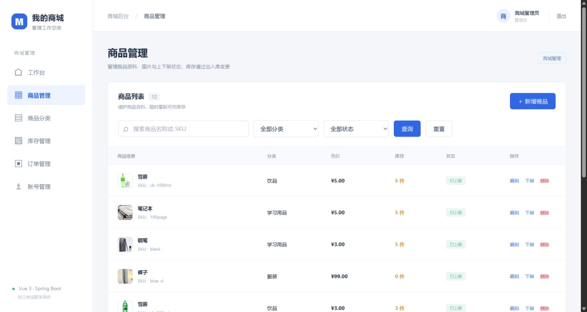
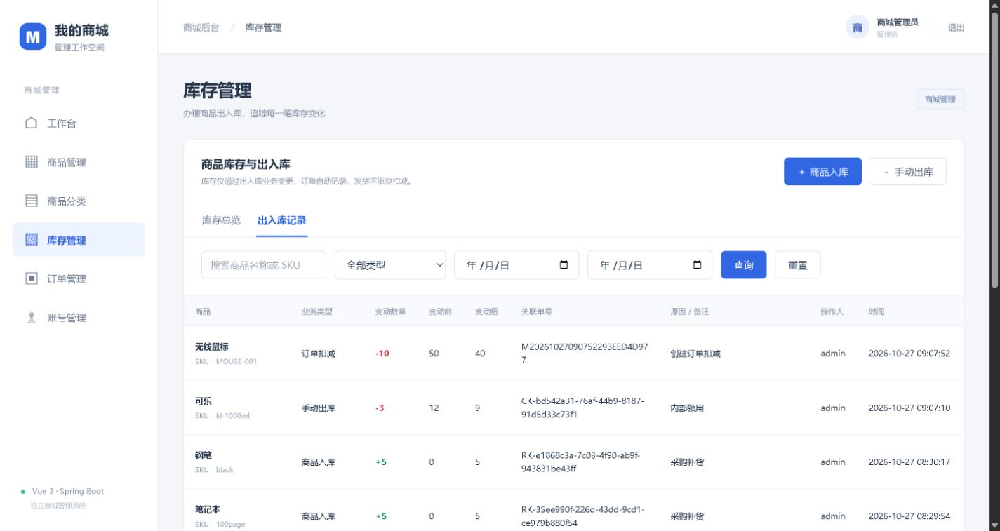
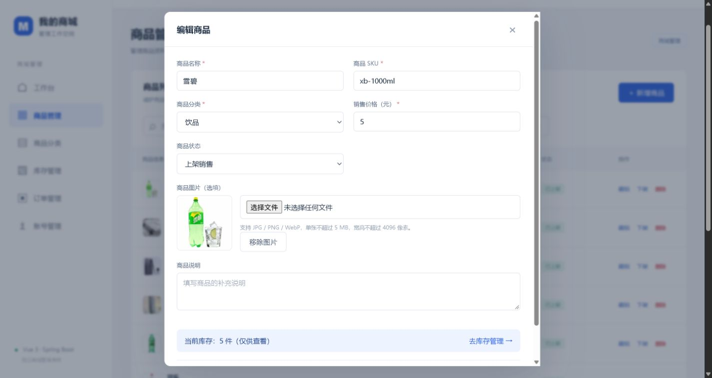

# 商城管理系统

基于 **Vue 3 + Spring Boot + MySQL / H2** 的前后端分离商城管理后台，面向商家管理员与员工，管理商品、分类、库存、订单及工作人员账号。

**作品集：** [查看 PDF](docs/mall-portfolio.pdf) · [在线阅读 PDF](https://mall-admin-portfolio-yiqian-20261018.yiqian7414.chatgpt.site/assets/mall-portfolio.pdf)

**获取源码：** [下载源码 ZIP](https://github.com/yiqian7414/mall-admin-system/archive/refs/heads/main.zip)，或使用下方 git clone 命令。更新日期：2026-10-27。

## 本轮功能更新

- 新增“库存管理”：库存总览、手动入库、手动出库、流水查询、类型和日期筛选、分页。
- 新商品库存固定为 **0**；新增和编辑表单没有库存输入框，后端商品接口同样不接受 stock。
- 所有运行期库存变更统一经过库存业务：记录变动前后数量、原因、关联单号、操作人和时间。
- 创建订单自动扣减，取消符合条件的订单时归还；付款、发货不重复扣减。
- 手动请求重试不会重复执行；行锁、事务及数量范围校验防止并发超扣和部分写入。
- 商品支持一张可选主图：JPG、PNG、WebP，原图不超过 5 MB、宽高各不超过 4096 像素；校验后重新编码保存。
- 旧数据库通过增量升级添加图片字段和流水表，登记旧库存基线，不重置已有商品或订单。

## 已实现功能

| 模块 | 功能 |
| --- | --- |
| 登录与权限 | Cookie/Session、CSRF、管理员/员工角色；账号管理仅管理员可用 |
| 经营概览 | 商品和订单数量、有效销售额、近期订单和低库存提示 |
| 分类与商品 | 分类维护、搜索、筛选、分页、SKU 唯一校验、主图、上下架及删除保护 |
| 库存 | 手动出入库、订单自动变动、只读流水、幂等、并发与事务控制 |
| 订单 | 多商品下单、价格金额快照、详情查询、合法状态流转及取消归还 |
| 账号 | 管理员创建、编辑、改密、停用或启用工作人员账号 |

订单流程：`待支付 → 已支付 → 已发货 → 已完成`。待支付、已支付订单可以取消，取消后保留记录；当前不提供订单删除。已有库存、库存流水或订单引用的商品应下架，不能直接删除。

## 实际界面

### 商品列表与主图



### 出入库记录



### 商品图片与库存只读



截图来自实际运行项目，只展示商品、库存和后台角色，不展示客户联系方式或本机连接凭据。

## 技术栈与结构

- 前端：Vue 3、JavaScript、Vue Router、Vite。
- 后端：Java 17、Spring Boot 3.5.16、Spring Security、Bean Validation。
- 数据访问：JdbcTemplate、参数化 SQL、事务、行锁。
- 数据库：独立 MySQL 8，另支持 H2 文件数据库。
- 图片：ImageIO 内容校验、WebP 解码、PNG 重新编码及持久文件存储。

```text
.
├── README.md
├── assets/                         实际界面截图
├── docs/
│   ├── mall-portfolio.pdf          PDF 作品集
│   ├── 库存管理与商品图片.md        新功能使用与代码流程
│   ├── 架构与接口.md
│   └── 逐行讲解/                   源码逐行说明及覆盖清单
└── 商城管理系统/
    ├── frontend-vue3/              Vue 源码、依赖清单及锁文件
    ├── backend/                    Java 源码、建表 SQL、配置、测试
    ├── scripts/                    工具链与 MySQL 准备脚本
    ├── 启动商城.ps1
    ├── 停止商城.ps1
    └── 检查项目.ps1
```

## 运行方法

一键脚本用于 Windows PowerShell 5.1 及以上。需要 JDK 17+、Maven 3.6.3+、Node.js `^22.18.0 || >=24.12.0`。配置 JAVA_HOME；Maven、Node、npm 加入 PATH，也支持 MAVEN_HOME。

### 快速体验：H2 文件数据库

```powershell
git clone https://github.com/yiqian7414/mall-admin-system.git
cd ".\mall-admin-system\商城管理系统"
.\启动商城.ps1 -Database h2
```

首次运行会联网安装依赖并构建。浏览器访问 http://127.0.0.1:5174/ ，后端健康检查为 http://127.0.0.1:8081/api/health 。

H2 保存到 `backend/data/`，重启保留数据。已有构建且没有修改后端代码时可使用 `.\启动商城.ps1 -Database h2 -SkipBuild`。

### 使用 MySQL

默认脚本约定 MySQL 位于 `C:\MySQL\MySQL Server 8.0`，使用项目独立的 `127.0.0.1:3307 / mall_admin`。安装位置不同时，按实际位置调整脚本的 MySQL 工具路径，再运行 `.\启动商城.ps1`。

仓库不携带本机数据库和连接凭据；新电脑按实际环境单独初始化。MySQL 与 H2 各自保存数据，切换不会自动迁移。

首次初始化的学习账号：

| 角色 | 用户名 | 初始密码 |
| --- | --- | --- |
| 管理员 | admin | Admin@123456 |
| 员工 | staff | Staff@123456 |

修改密码后，重启不会恢复初始密码。

### 停止与检查

```powershell
# 关闭前后端，保留 MySQL
.\停止商城.ps1 -KeepDatabase

# 独立 H2 内存库集成测试 + 前端生产构建
.\检查项目.ps1
```

需要同时停止 MySQL 时，可运行 `.\停止商城.ps1`，前提是本机配置中的数据库管理员密码与实际一致。关闭 DataGrip 只会断开客户端连接。

## 操作示例与数据保存

1. 新建商品，库存固定为 0；可先设为下架。
2. 库存管理中采购入库 10 件，库存变为 10。
3. 上架商品，创建购买 2 件的订单，库存变为 8。
4. 取消该订单，库存恢复为 10；重复取消会被拒绝。
5. 商品报损或内部领用办理手动出库；订单发货无需再手动出库。

主图默认保存在 `商城管理系统/backend/data/uploads/products/`，数据库仅保存图片地址。移除商品图片会清除引用，当前不自动删除磁盘文件。迁移时应同时保留数据库和上传目录；这些本机数据不会自动进入 GitHub。

## 本轮验证

2026-10-27 对发布副本重新运行：**15 项后端集成测试通过，前端 npm ci 与生产构建通过。**

测试覆盖权限、CSRF、输入校验、商品接口禁止改库存、重复提交、并发扣减、订单回滚、取消归还、旧库升级及 JPG/PNG/WebP 图片处理。测试使用独立 H2 内存库，不读写运行中的商城 MySQL。

## 项目范围与分工

这是商家管理后台。顾客购买信息由工作人员录入，付款及发货状态由工作人员人工确认。尚未接入顾客购物端、购物车、真实在线支付、物流、优惠券或退款服务。

成员姓名与实际分工暂不填写，不以功能清单代替个人贡献说明。

## 学习资料

[库存与图片功能](docs/库存管理与商品图片.md) · [架构与接口](docs/架构与接口.md) · [前端说明](docs/前端学习说明.md) · [后端说明](docs/后端学习说明.md) · [逐行讲解](docs/逐行讲解.md)

源码不包含本机密码、数据库备份、客户数据、上传原文件、依赖缓存或构建产物。`schema.sql` 是表结构定义，不是开发者数据库的实时数据导出。
