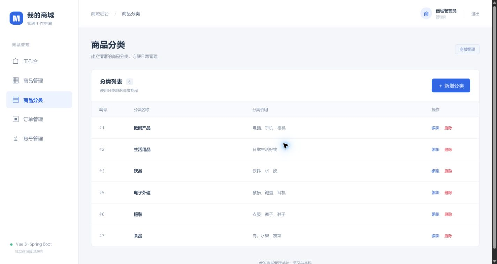
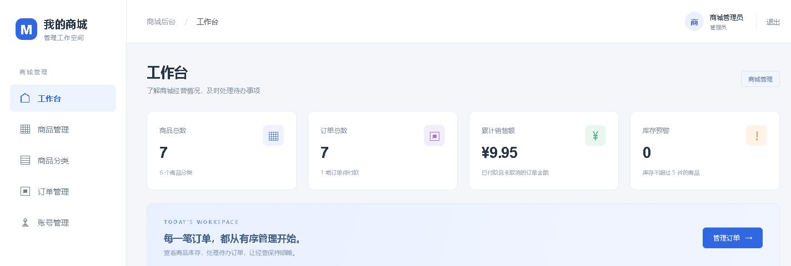

# 商城管理系统

基于 **Vue 3 + Spring Boot + MySQL / H2** 的前后端分离商城管理后台，面向商家管理员与员工，用于维护商品、分类、库存、订单及工作人员账号。
## 已实现功能

| 模块 | 功能 |
| --- | --- |
| 登录与权限 | Cookie 会话、CSRF、管理员和员工角色；账号管理仅管理员可用 |
| 经营概览 | 商品和订单数量、有效销售额、近期订单及低库存提示 |
| 分类与商品 | 分类维护，商品新增、查询、筛选、分页、编辑、上下架和删除保护；SKU 唯一 |
| 库存 | 创建订单自动扣减库存，取消订单按业务规则归还库存，重复取消不会重复归还 |
| 订单 | 多商品下单、金额快照、收货信息、详情和合法状态流转 |
| 账号 | 管理员创建、编辑、修改密码、停用和启用工作人员账号 |

订单流程：`待支付 → 已支付 → 已发货 → 已完成`；待支付和已支付订单可以取消，取消后保留记录。付款及发货状态由工作人员人工确认。当前没有订单删除功能。

## 真实界面

### 商品管理


### 商品分类



### 经营概览



截图来自实际运行的本地项目；订单客户、电话和收货地址未作为展示截图发布。

## 技术栈与结构

- 前端：Vue 3、JavaScript、Vue Router、Vite。
- 后端：Java 17、Spring Boot、Spring Security、Bean Validation。
- 数据访问：JdbcTemplate、参数化 SQL、事务与行锁。
- 数据库：默认独立 MySQL 8，另支持 H2 文件数据库。

```text
.
├── README.md
├── assets/                     项目截图
├── docs/                       前后端结构及业务说明
└── 商城管理系统/
    ├── frontend-vue3/          Vue 源码、依赖清单与锁文件
    ├── backend/                Java 源码、SQL、配置与测试
    ├── scripts/                工具链与 MySQL 准备脚本
    ├── 启动商城.ps1
    ├── 停止商城.ps1
    └── 检查项目.ps1
```

## 运行方法

现有一键脚本用于 Windows PowerShell 5.1 及以上。准备 JDK 17 及以上、Maven 3.6.3 及以上，以及 Node.js `^22.18.0 || >=24.12.0`。将 `JAVA_HOME` 指向 JDK 安装目录，Maven、Node.js 与 npm 应可从 PATH 找到；也支持 `MAVEN_HOME`。

### 快速体验：H2 文件数据库

不额外安装 MySQL 时，可以先使用 H2 体验完整后台功能：

```powershell
git clone https://github.com/yiqian7414/mall-admin-system.git
cd ".\mall-admin-system\商城管理系统"
.\启动商城.ps1 -Database h2
```

脚本首次运行会下载 Maven/npm 依赖并构建，需联网。启动完成后，在本机浏览器打开 http://127.0.0.1:5174/ 。后端接口位于 http://127.0.0.1:8081/api/health 。

已有构建结果且未修改后端源码时，可以使用 `.\启动商城.ps1 -Database h2 -SkipBuild`。H2 数据保存在后端 `data/` 目录，重启仍保留。

### 使用 MySQL

默认脚本约定 MySQL 安装目录为 `C:\MySQL\MySQL Server 8.0`，使用项目专用 `127.0.0.1:3307 / mall_admin`。该目录与本机实际安装位置不同时，需按安装位置调整脚本的 MySQL 工具路径，再运行 `.\启动商城.ps1`。

首次准备会创建项目自己的数据库目录和连接配置。仓库未包含开发者的 `.runtime` 凭据或数据库数据，新电脑按实际环境单独初始化。MySQL 与 H2 是两份独立数据，切换不会自动迁移。

初次初始化的网页账号：

| 角色 | 用户名 | 初始密码 |
| --- | --- | --- |
| 管理员 | admin | Admin@123456 |
| 员工 | staff | Staff@123456 |

这些是本地学习用的种子账号；改密后重启不会恢复初始密码。正式部署需要另行设置账号和运行环境。

### 停止与检查

关闭前后端并保留独立 MySQL 运行：

```powershell
.\停止商城.ps1 -KeepDatabase
```

若使用 MySQL，需要同时停止数据库时，可执行 `.\停止商城.ps1`；前提是本机连接配置中的管理员密码与 MySQL 实际密码一致。关闭 DataGrip 只会断开客户端连接，不会停止 MySQL。

运行后端集成测试和前端构建：

```powershell
.\检查项目.ps1
```

集成测试使用独立 H2 内存库，覆盖权限、CSRF、输入校验、订单回滚、库存及状态规则等，不读写运行中的商城数据库。

## 验收要点

1. 管理员能使用账号管理功能，员工无法访问该功能。
2. 商品可以新增、搜索、修改和上下架；重复 SKU 被拒绝；刷新后保存的数据仍在。
3. 演示商品库存设为 10，创建购买 2 件的订单后为 8，取消后恢复为 10，重复取消不会再次增加库存。

## 项目范围与分工

系统提供商家管理后台，顾客购买信息由工作人员录入。暂未实现顾客自主注册购物、购物车、真实在线支付、物流对接、优惠券或退款服务。

**成员与分工：** 按提交要求后续填写真实姓名及实际负责内容，当前暂不填写。

演示视频已加入作品集页面，展示登录、商品管理和订单操作。作品集为静态介绍页，不提供在线后台登录操作。

## 补充说明

[前端结构与请求流程](docs/前端学习说明.md) · [后端分层与业务规则](docs/后端学习说明.md) · [本机运行说明](商城管理系统/README.md)

本机数据库、运行凭据、日志、依赖缓存及构建产物均未随源码上传，源码中只保留配置读取方式和学习用初始化数据。
